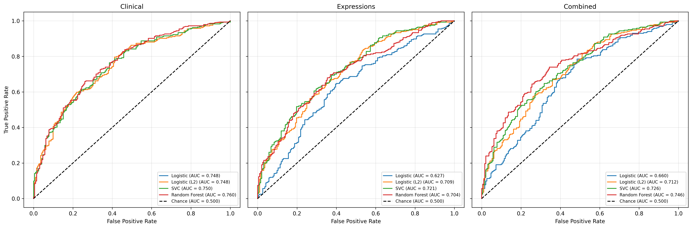
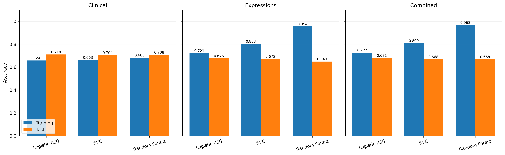
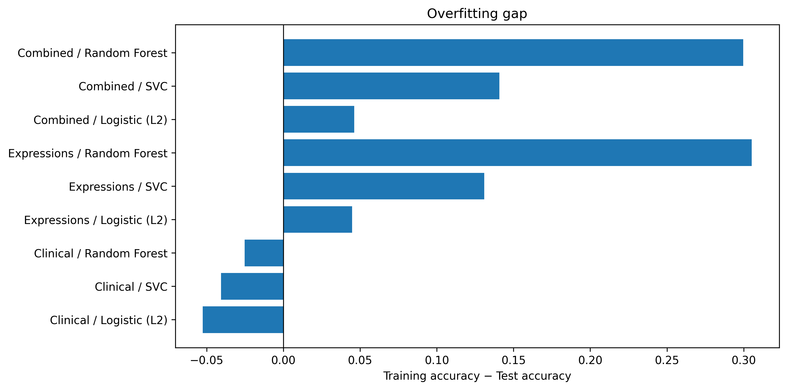

# Analysis

## Data Preprocessing

```{python}
import mglearn
import pandas as pd
import numpy as np
import os
import joblib
import matplotlib.pyplot as plt
from sklearn.model_selection import train_test_split 
from sklearn.preprocessing import MinMaxScaler
from sklearn.linear_model import LogisticRegression 
from sklearn.metrics import roc_curve, roc_auc_score
from sklearn.ensemble import RandomForestClassifier
from sklearn.model_selection import GridSearchCV, StratifiedKFold
from sklearn.model_selection import cross_val_score, StratifiedKFold
from sklearn.svm import SVC
from sklearn.metrics import RocCurveDisplay
```

Import data

```{python}
data = pd.read_csv("./data/METABRIC_RNA_Mutation.csv")

clinical_documented_cols = data.columns[:31].tolist()
mutation_cols = [c for c in data.columns if c.lower().endswith("_mut")]
expression_cols = [
    c for c in data.columns[31:]
    if c not in mutation_cols
]
```

Extract clinical, and expression data. We exclude exclude tumor stage because it have many missing values. We selected `age_at_diagnosis`, `nottingham_prognostic_index categorical`, `er_status`, `her2_status`, `pr_status`.

The `nottingham_prognostic_index categorical` is continuous data, so we convert it to categorical data, and then create dummy variables for it.

```{python}
npi_cat = pd.cut(
    data["nottingham_prognostic_index"],
    bins=[-np.inf, 2.4, 3.4, 4.4, 5.4, np.inf],
    labels=["excellent", "good", "moderate_1", "moderate_2", "poor"],
    right=True,
)
npi_dummies = pd.get_dummies(npi_cat, prefix="npi", dtype=int)
npi_dummies.head()
```

The status variables are categorical, so we create binary variables for them.

```{python}
data[["er_status", "pr_status", "her2_status"]] = data[["er_status", "pr_status", "her2_status"]].replace({"Negative": 0, "Positive": 1})
data[["er_status", "pr_status", "her2_status"]].head()
```

Select the clinical variables variables.

```{python}
selected_clinical = ["age_at_diagnosis", "er_status", "pr_status", "her2_status"]
## combine the selected clinical variables and NPI dummies into a single dataframe
X = pd.concat([data[selected_clinical], npi_dummies], axis=1)
```

The outcome are overall survival, which is a binary variable. But it is currently coded as 1 for survived and 0 for died. We create a new variable `surv` that is 0 if the patient survived and 1 if the patient died.

```{python}
data["surv"] = np.where(data["overall_survival"] == 1, 0, 1)
## select the binary outcome
Y = data["surv"]
```

Training and testing split

```{python}
## split the data into training and testing sets
X_train, X_test, y_train, y_test = train_test_split(X, Y, random_state=0)
```

However, the `age_at_diagnosis` variable is continuous, and the other variables are binary. We need to normalize the continuous variable. So we slect min-max normalization to scale the `age_at_diagnosis` variable to the range [0, 1].

Before scaling

```{python}
print("Min age at diagnosis:", X_train["age_at_diagnosis"].min(), "Max age at diagnosis:", X_train["age_at_diagnosis"].max())
```

Scaling

```{python}
scaler = MinMaxScaler()

X_train = X_train.copy()
X_test = X_test.copy()

X_train[["age_at_diagnosis"]] = scaler.fit_transform(X_train[["age_at_diagnosis"]])  
X_test[["age_at_diagnosis"]] = scaler.transform(X_test[["age_at_diagnosis"]])        
```

After scaling

```{python}
print("Min age at diagnosis:", X_train["age_at_diagnosis"].min(), "Max age at diagnosis:", X_train["age_at_diagnosis"].max())
```

## Model with clinical variables

### Logistic Regression

```{python}
## fit logistic regression model
logistic_clinical = LogisticRegression(penalty= None).fit(X_train, y_train)
```

Mean accuracy on the training and testing sets

```{python}
print('Training Accuracy :',logistic_clinical.score(X_train, y_train))
print('Test Accuracy :',logistic_clinical.score(X_test, y_test))
```

ROC-AUC score on the testing sets 

```{python}
y_prob = logistic_clinical.predict_proba(X_test)[:, 1]   # probability of the positive class
auc = roc_auc_score(y_test, y_prob)
print(f"Test ROC-AUC: {auc:.3f}")
```

### Lasso Regression

In Lasso regression, we use 5-fold cross-validation to select the best regularization parameter. 

```{python}
cv = StratifiedKFold(n_splits=5, shuffle=True, random_state=123)
C_values = [0.001, 0.01, 0.1, 1, 10, 100]

results = {}
for C in C_values:
    model = LogisticRegression(penalty='l2', C=C, max_iter=10000)
    scores = cross_val_score(model, X_train, y_train, cv=cv, scoring="roc_auc")
    results[C] = scores
    print(f"C={C:<7} | fold accuracies: {scores.round(3)} | mean: {scores.mean():.3f}")

best_C = max(results, key=lambda c: results[c].mean())
print("Best C by mean CV accuracy:", best_C)
```

So we choose C = `{python} best_C` as the best regularization parameter. We fit the model with the best regularization parameter and evaluate the model on the training and testing sets.

```{python}
logistic_clinical_l2 = LogisticRegression(penalty='l2', C=best_C, max_iter=10000).fit(X_train, y_train)
print('Training Accuracy :',logistic_clinical_l2.score(X_train, y_train))
print('Test Accuracy :',logistic_clinical_l2.score(X_test, y_test))
```

ROC-AUC score on the testing sets 

```{python}
y_prob = logistic_clinical_l2.predict_proba(X_test)[:, 1]   # probability of the positive class
auc = roc_auc_score(y_test, y_prob)
print(f"Test ROC-AUC: {auc:.3f}")
```

### Random Forest

We used 5-fold cross-validation to select the best hyperparameters for the random forest model. We used a grid search to search over a range of hyperparameters, including the number of trees in the forest (`n_estimators`), the maximum depth of the trees (`max_depth`), and the minimum number of samples required to split an internal node (`min_samples_split`), number of samples required to be at a leaf node (`min_samples_leaf`).

```{python}
model_path = "models/rf_grid_search.joblib"

if os.path.exists(model_path):
    grid_search = joblib.load(model_path)          
else:
    cv = StratifiedKFold(n_splits=5, shuffle=True, random_state=123)
    rf = RandomForestClassifier(random_state=123)

    param_grid = {
        "max_depth": [5, 10, 15],
        "min_samples_leaf": [2, 5, 10, 20],
        "min_samples_split": [5, 10, 20],
        "n_estimators": range(10, 101, 10),
    }

    grid_search = GridSearchCV(
        estimator=rf,
        param_grid=param_grid,
        cv=cv,
        scoring="roc_auc",
        return_train_score=True,
        n_jobs=-1,                                 
    )
    grid_search.fit(X_train, y_train)
    joblib.dump(grid_search, model_path) 
```

Best hyperparameters

```{python}
print("Best parameters:", grid_search.best_params_)
```

Perfromance of random forest model with clinical variables on the training and testing sets

```{python}
rf_clinical = grid_search.best_estimator_    
print("Training accuracy:", rf_clinical.score(X_train, y_train))
print("Test accuracy:", rf_clinical.score(X_test, y_test))
```

ROC-AUC score on the testing sets 

```{python}
y_prob = rf_clinical.predict_proba(X_test)[:, 1]   # probability of the positive class
auc = roc_auc_score(y_test, y_prob)
print(f"Test ROC-AUC: {auc:.3f}")
```

### Support Vector Machine

We used 5-fold cross-validation to select the best hyperparameters for the support vector machine model. We used a grid search to search over a range of hyperparameters, including the regularization parameter (`C`), and the gamma type (`gamma`).

```{python}
svc_path = "models/svc_grid_search.joblib"

if os.path.exists(svc_path):
    grid_search_svc = joblib.load(svc_path)
else:
    param_grid = {
        "C": [0.001, 0.01, 0.1, 1, 10, 100],
        "gamma": [0.001, 0.01, 0.1, 1, 10, 100],
    }

    grid_search_svc = GridSearchCV(
        SVC(), param_grid, cv=5, scoring="roc_auc",
        return_train_score=True                     
    )
    grid_search_svc.fit(X_train, y_train)
    joblib.dump(grid_search_svc, svc_path)
```

Best hyperparameters

```{python}
print("Best parameters:", grid_search_svc.best_params_)
```

Performance of support vector machine model with clinical variables on the training and testing sets

```{python}
print("Best ROC-AUC score:", grid_search_svc.best_score_)
print("Test set score:", grid_search_svc.score(X_test, y_test))
```

ROC-AUC score on the testing sets 

```{python}
svc_clinical = grid_search_svc.best_estimator_
y_score = svc_clinical.decision_function(X_test)
auc = roc_auc_score(y_test, y_score)
print(f"Test ROC-AUC: {auc:.3f}")
```


```{python}
models = {
    "Logistic (L2)": logistic_clinical_l2,
    "SVC": svc_clinical,
    "Random Forest": rf_clinical,
}

fig, ax = plt.subplots(figsize=(7, 6))
for name, model in models.items():
    RocCurveDisplay.from_estimator(model, X_test, y_test, ax=ax, name=name)

ax.plot([0, 1], [0, 1], "k--", label="Chance (AUC = 0.5)")
ax.legend(loc="lower right")
ax.set_title("ROC curves on the test set")
plt.show()
```

## Model with gene expression variables

Data extraction

```{python}
X_expressions = data[expression_cols]
## split the expression data into training and testing sets

X_expression_train, X_expression_test = train_test_split(X_expressions, random_state=0)
```

### Logistic Regression

```{python}
logistic_expression = LogisticRegression(penalty=None, max_iter=10000).fit(X_expression_train, y_train)
```

```{python}
print('Training Accuracy :',logistic_expression.score(X_expression_train, y_train))
print('Test Accuracy :',logistic_expression.score(X_expression_test, y_test))
```

```{python}
y_prob = logistic_expression.predict_proba(X_expression_test)[:, 1]  
auc = roc_auc_score(y_test, y_prob)
print(f"Test ROC-AUC: {auc:.3f}")
```

### Lasso Regression

```{python}
cv = StratifiedKFold(n_splits=5, shuffle=True, random_state=123)
C_values = [0.001, 0.01, 0.1, 1, 10, 100]

results = {}
for C in C_values:
    model = LogisticRegression(penalty='l2', C=C, max_iter=10000)
    scores = cross_val_score(model, X_expression_train, y_train, cv=cv, scoring="roc_auc")
    results[C] = scores
    print(f"C={C:<7} | fold accuracies: {scores.round(3)} | mean: {scores.mean():.3f}")

best_C = max(results, key=lambda c: results[c].mean())
print("Best C by mean CV accuracy:", best_C)
```

```{python}
logistic_expression_l2 = LogisticRegression(penalty='l2', C=best_C, max_iter=10000).fit(X_expression_train, y_train)
print('Mean Training Accuracy :',logistic_expression_l2.score(X_expression_train, y_train))
print('Mean Test Accuracy :',logistic_expression_l2.score(X_expression_test, y_test))
```

```{python}
y_prob = logistic_expression_l2.predict_proba(X_expression_test)[:, 1]   # probability of the positive class
auc = roc_auc_score(y_test, y_prob)
print(f"Test ROC-AUC: {auc:.3f}")
```

### Random Forest

```{python}
rf_ex_path = "models/rf__ex_grid_search.joblib"

if os.path.exists(rf_ex_path):
    grid_search = joblib.load(rf_ex_path)          
else:
    cv = StratifiedKFold(n_splits=5, shuffle=True, random_state=123)
    rf = RandomForestClassifier(random_state=123)

    param_grid = {
        "max_depth": [5, 10, 15],
        "min_samples_leaf": [2, 5, 10, 20],
        "min_samples_split": [5, 10, 20],
        "n_estimators": range(10, 101, 10),
    }

    grid_search = GridSearchCV(
        estimator=rf,
        param_grid=param_grid,
        cv=cv,
        scoring="roc_auc",
        return_train_score=True,
        n_jobs=-1,                                 
    )
    grid_search.fit(X_expression_train, y_train)
    joblib.dump(grid_search, rf_ex_path) 
```

```{python}
print("Best parameters:", grid_search.best_params_)
```

```{python}
rf_expression = grid_search.best_estimator_    
print("Training accuracy:", rf_expression.score(X_expression_train, y_train))
print("Test accuracy:", rf_expression.score(X_expression_test, y_test))
```

```{python}
y_prob = rf_expression.predict_proba(X_expression_test)[:, 1]   # probability of the positive class
auc = roc_auc_score(y_test, y_prob)
print(f"Test ROC-AUC: {auc:.3f}")
```

### Support Vector Machine

```{python}
svc_ex_path = "models/svc_ex_grid_search.joblib"

if os.path.exists(svc_ex_path):
    grid_search_svc = joblib.load(svc_ex_path)
else:
    param_grid = {
        "C": [0.001, 0.01, 0.1, 1, 10, 100],
        "gamma": [0.001, 0.01, 0.1, 1, 10, 100],
    }

    grid_search_svc = GridSearchCV(
        SVC(), param_grid, cv=5, scoring="roc_auc",
        return_train_score=True                     
    )
    grid_search_svc.fit(X_expression_train, y_train)
    joblib.dump(grid_search_svc, svc_ex_path)
```

```{python}
print("Best parameters:", grid_search_svc.best_params_)
```

```{python}
print("Best ROC-AUC score:", grid_search_svc.best_score_)
print("Test set score:", grid_search_svc.score(X_expression_test, y_test))
```

```{python}
svc_expression = grid_search_svc.best_estimator_
y_score = svc_expression.decision_function(X_expression_test)
auc = roc_auc_score(y_test, y_score)
print(f"Test ROC-AUC: {auc:.3f}")
```

Visualization

```{python}
models = {
    "Logistic (L2)": logistic_expression_l2,
    "SVC": svc_expression,
    "Random Forest": rf_expression,
}

fig, ax = plt.subplots(figsize=(7, 6))
for name, model in models.items():
    RocCurveDisplay.from_estimator(model, X_expression_test, y_test, ax=ax, name=name)

ax.plot([0, 1], [0, 1], "k--", label="Chance (AUC = 0.5)")
ax.legend(loc="lower right")
ax.set_title("ROC curves on the test set")
plt.show()
```

## Model with clinical and gene expression variables

Data extraction

```{python}
X_combined_train = pd.concat([X_train, X_expression_train], axis=1)
X_combined_test = pd.concat([X_test, X_expression_test], axis=1)
```

### Logistic Regression

```{python}
logistic_combined = LogisticRegression(penalty=None, max_iter=10000).fit(X_combined_train, y_train)
```

```{python}
print('Mean Training Accuracy :',logistic_combined.score(X_combined_train, y_train))
print('Mean Test Accuracy :',logistic_combined.score(X_combined_test, y_test))
```

### Lasso Regression

```{python}
cv = StratifiedKFold(n_splits=5, shuffle=True, random_state=123)
C_values = [0.001, 0.01, 0.1, 1, 10, 100]

results = {}
for C in C_values:
    model = LogisticRegression(penalty='l2', C=C, max_iter=10000)
    scores = cross_val_score(model, X_combined_train, y_train, cv=cv, scoring="roc_auc")
    results[C] = scores
    print(f"C={C:<7} | fold accuracies: {scores.round(3)} | mean: {scores.mean():.3f}")

best_C = max(results, key=lambda c: results[c].mean())
print("Best C by mean CV accuracy:", best_C)
```

```{python}
logistic_combined_l2 = LogisticRegression(penalty='l2', C=best_C, max_iter=10000).fit(X_combined_train, y_train)
print('Mean Training Accuracy :',logistic_combined_l2.score(X_combined_train, y_train))
print('Mean Test Accuracy :',logistic_combined_l2.score(X_combined_test, y_test))
```

```{python}
y_prob = logistic_combined_l2.predict_proba(X_combined_test)[:, 1]   # probability of the positive class
auc = roc_auc_score(y_test, y_prob)
print(f"Test ROC-AUC: {auc:.3f}")
```

### Random forest

```{python}
rf_combined_path = "models/rf_combined_grid_search.joblib"

if os.path.exists(rf_combined_path):
    grid_search = joblib.load(rf_combined_path)          
else:
    cv = StratifiedKFold(n_splits=5, shuffle=True, random_state=123)
    rf = RandomForestClassifier(random_state=123)

    param_grid = {
        "max_depth": [5, 10, 15],
        "min_samples_leaf": [2, 5, 10, 20],
        "min_samples_split": [5, 10, 20],
        "n_estimators": range(10, 101, 10),
    }

    grid_search = GridSearchCV(
        estimator=rf,
        param_grid=param_grid,
        cv=cv,
        scoring="roc_auc",
        return_train_score=True,
        n_jobs=-1,                                 
    )
    grid_search.fit(X_combined_train, y_train)
    joblib.dump(grid_search, rf_combined_path) 
```

```{python}
print("Best parameters:", grid_search.best_params_)
```

```{python}
rf_combined = grid_search.best_estimator_    
print("Training accuracy:", rf_combined.score(X_combined_train, y_train))
print("Test accuracy:", rf_combined.score(X_combined_test, y_test))
```

```{python}
y_prob = rf_combined.predict_proba(X_combined_test)[:, 1]   # probability of the positive class
auc = roc_auc_score(y_test, y_prob)
print(f"Test ROC-AUC: {auc:.3f}")
```

### Support Vector Machine

```{python}
svc_combined_path = "models/svc_combined_grid_search.joblib"

if os.path.exists(svc_combined_path):
    grid_search_svc = joblib.load(svc_combined_path)
else:
    param_grid = {
        "C": [0.001, 0.01, 0.1, 1, 10, 100],
        "gamma": [0.001, 0.01, 0.1, 1, 10, 100],
    }

    grid_search_svc = GridSearchCV(
        SVC(), param_grid, cv=5, scoring="roc_auc",
        return_train_score=True                     
    )
    grid_search_svc.fit(X_combined_train, y_train)
    joblib.dump(grid_search_svc, svc_combined_path)
```

```{python}
print("Best parameters:", grid_search_svc.best_params_)
```

```{python}
print("Best ROC-AUC score:", grid_search_svc.best_score_)
print("Test set score:", grid_search_svc.score(X_combined_test, y_test))
```

```{python}
svc_combined = grid_search_svc.best_estimator_
y_score = svc_combined.decision_function(X_combined_test)
auc = roc_auc_score(y_test, y_score)
print(f"Test ROC-AUC: {auc:.3f}")
```

Visualization

```{python}
models = {
    "Logistic (L2)": logistic_combined_l2,
    "SVC": svc_combined,
    "Random Forest": rf_combined,
}

fig, ax = plt.subplots(figsize=(7, 6))
for name, model in models.items():
    RocCurveDisplay.from_estimator(model, X_combined_test, y_test, ax=ax, name=name)

ax.plot([0, 1], [0, 1], "k--", label="Chance (AUC = 0.5)")
ax.legend(loc="lower right")
ax.set_title("ROC curves on the test set")
plt.show()
```

## Comparision between 3 models

### ROC-AUC

```{python}
def get_score(model, X):
    """Return continuous scores for ROC, aligning X to the columns the model was fit on."""
    # reorder/select test columns to exactly match training columns (fixes name/order errors)
    if isinstance(X, pd.DataFrame) and hasattr(model, "feature_names_in_"):
        X = X[list(model.feature_names_in_)]

    # prefer decision_function (logistic, SVC); fall back to predict_proba (random forest)
    if hasattr(model, "decision_function"):
        return model.decision_function(X)
    return model.predict_proba(X)[:, 1]


def plot_roc_facets(facets, y, figsize=(18, 6)):
    fig, axes = plt.subplots(1, len(facets), figsize=figsize, sharey=True)
    axes = [axes] if len(facets) == 1 else axes

    for ax, (title, (models, X)) in zip(axes, facets.items()):
        for name, model in models.items():
            try:
                score = get_score(model, X)
            except Exception as e:
                raise RuntimeError(f"Failed on facet '{title}', model '{name}': {e}") from e

            fpr, tpr, _ = roc_curve(y, score)
            auc = roc_auc_score(y, score)
            ax.plot(fpr, tpr, label=f"{name} (AUC = {auc:.3f})")

        ax.plot([0, 1], [0, 1], "k--", label="Chance (AUC = 0.500)")
        ax.set(title=title, xlabel="False Positive Rate")
        ax.legend(loc="lower right", fontsize=8)
        ax.grid(alpha=0.3)

    axes[0].set_ylabel("True Positive Rate")
    plt.tight_layout()
    return fig


facets = {
    "Clinical": (
        {"Logistic": logistic_clinical, "Logistic (L2)": logistic_clinical_l2, "SVC": svc_clinical, "Random Forest": rf_clinical},
        X_test,
    ),
    "Expressions": (
        {"Logistic": logistic_expression, "Logistic (L2)": logistic_expression_l2, "SVC": svc_expression, "Random Forest": rf_expression},
        X_expression_test,
    ),
    "Combined": (
        {"Logistic": logistic_combined, "Logistic (L2)": logistic_combined_l2, "SVC": svc_combined, "Random Forest": rf_combined},
        X_combined_test,
    ),
}

fig = plot_roc_facets(facets, y_test)
fig.savefig("./figs/roc_facets.png", dpi=300, bbox_inches="tight")
plt.close(fig)
```




::: {.callout-note}

- Clinical only models are better than gene expression only and combined models

- Combined model still not increase the prediction performance: AUC of combined random forest is 0.746, while RF of clinical is 0.76

:::


### Score

```{python}
# (model, train features, test features) for each combination
runs = {
    ("Clinical", "Logistic"):         (logistic_clinical,      X_train,             X_test),
    ("Clinical", "Logistic (L2)"):    (logistic_clinical_l2,   X_train,             X_test),
    ("Clinical", "SVC"):              (svc_clinical,           X_train,             X_test),
    ("Clinical", "Random Forest"):    (rf_clinical,            X_train,             X_test),
    ("Expressions", "Logistic"):      (logistic_expression,    X_expression_train,  X_expression_test),
    ("Expressions", "Logistic (L2)"): (logistic_expression_l2, X_expression_train,  X_expression_test),
    ("Expressions", "SVC"):           (svc_expression,         X_expression_train,  X_expression_test),
    ("Expressions", "Random Forest"): (rf_expression,          X_expression_train,  X_expression_test),
    ("Combined", "Logistic"):         (logistic_combined,      X_combined_train,    X_combined_test),
    ("Combined", "Logistic (L2)"):    (logistic_combined_l2,   X_combined_train,    X_combined_test),
    ("Combined", "SVC"):              (svc_combined,           X_combined_train,    X_combined_test),
    ("Combined", "Random Forest"):    (rf_combined,            X_combined_train,    X_combined_test),
}

rows = []
for (features, name), (model, Xtr, Xte) in runs.items():
    train_acc = model.score(Xtr, y_train)
    test_acc = model.score(Xte, y_test)
    rows.append({
        "Features": features,
        "Model": name,
        "Train": train_acc,
        "Test": test_acc,
        "Gap": train_acc - test_acc,
    })

scores = pd.DataFrame(rows)
print(scores.round(3))

# grouped bars: one panel per feature set
fig, axes = plt.subplots(1, 3, figsize=(16, 5), sharey=True)
for ax, (features, df) in zip(axes, scores.groupby("Features", sort=False)):
    x = range(len(df))
    w = 0.38
    ax.bar([i - w/2 for i in x], df["Train"], width=w, label="Training")
    ax.bar([i + w/2 for i in x], df["Test"], width=w, label="Test")
    for i, (tr, te) in enumerate(zip(df["Train"], df["Test"])):
        ax.text(i - w/2, tr + 0.01, f"{tr:.3f}", ha="center", fontsize=8)
        ax.text(i + w/2, te + 0.01, f"{te:.3f}", ha="center", fontsize=8)
    ax.set_xticks(list(x))
    ax.set_xticklabels(df["Model"], rotation=15)
    ax.set_title(features)
    ax.set_ylim(0, 1.1)
    ax.grid(axis="y", alpha=0.3)

axes[0].set_ylabel("Accuracy")
axes[0].legend(loc="lower left")
plt.tight_layout()
fig.savefig("./figs/accuracy_train_vs_test.png", dpi=300, bbox_inches="tight")
plt.close(fig)
```




::: {.callout-note}

- In high dimensional data (Expressions and combined data), the Lasso regression will improve the performance of the Logistic regression model rather than the low dimensional data (Clinical data).

:::


### Accuracy different between trainning and testing set

```{python}
fig_gap, ax = plt.subplots(figsize=(10, 5))     # new, separate figure object
scores["Label"] = scores["Features"] + " / " + scores["Model"]
ax.barh(scores["Label"], scores["Gap"])
ax.axvline(0, color="k", lw=0.8)
ax.set_xlabel("Training accuracy − Test accuracy")
ax.set_title("Overfitting gap")
plt.tight_layout()

fig_gap.savefig("./figs/overfitting_gap.png", dpi=300, bbox_inches="tight")
plt.close(fig_gap)
```

